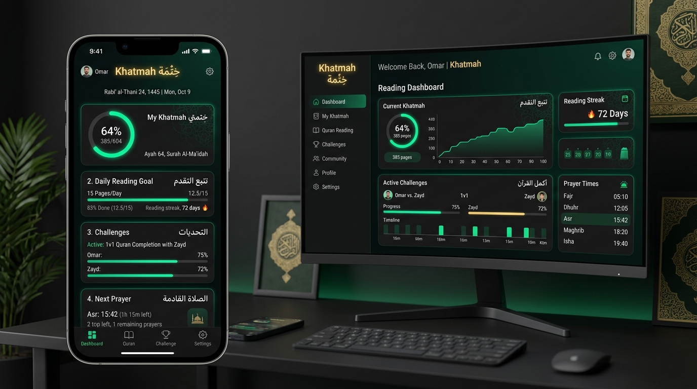

# Khatmah (خِتْمَة) — Gamified Quran Reading & Completion Platform

> **Khatmah (خِتْمَة)** is an interactive, gamified Quran reading platform designed to build consistency in daily recitation through goal tracking, reading streaks, 1v1 completion challenges, and integrated prayer time utilities.

---

---

## 🌟 Overview

Completing a full reading of the Holy Quran (*Khatmah*) requires consistency and habit-building. **Khatmah** combines traditional spiritual reading with modern gamification techniques — helping users set daily reading goals, track visual progress, challenge friends to friendly 1v1 recitation races, and stay aligned with localized prayer schedules.

---

## 🚀 Key Features & Capabilities

### 📖 1. Interactive Quran Reader & Progress Tracker
* **Digital Mushaf Reader**: Beautiful typography using custom **Amiri** and **Geist** fonts for an effortless reading experience.
* **Granular Tracking**: Log progress by Surah, Ayah, Juz', or page count.
* **Visual Dashboards**: Track completion percentages, daily reading targets, and active reading streaks.

### ⚔️ 2. Gamified 1v1 & Group Challenges
* **1v1 Completion Battles**: Create or join private rooms to challenge a friend/partner in completing a Khatmah.
* **Live Progress Bars**: Real-time comparative indicators showing who leads in daily reading milestones.
* **Community Rooms**: Form Quran completion circles during Ramadan or regular spiritual seasons.

### 🕌 3. Prayer Times & Islamic Utilities
* **Location-Based Prayer Times**: Accurate calculation schedules for daily prayers.
* **Prayer Time Countdown Widgets**: Visual indicators showing upcoming prayer times directly on the dashboard.

### 🌐 4. Native Bilingual Interface (Arabic & English)
* Full **RTL (Right-to-Left)** support for Arabic and **LTR** for English.
* Automatic locale detection and persistent user preferences.

---

## 🏗️ Technical Architecture Highlights

While the primary source codebase remains in a private repository, **Khatmah** was architected using modern web techniques for low-latency state synchronization and offline capability:

* **Framework**: Next.js (App Router, Turbopack, React 19).
* **Backend & Auth**: Supabase (Supabase Auth, SSR, Realtime PostgreSQL database).
* **Styling**: TailwindCSS with CSS variables for dynamic Dark Mode themes (`#101722`).
* **Icons & UI Elements**: Lucide React icons with custom Arabic typography integration.
* **Emails & Notifications**: Resend API integration for milestone notifications and room invites.

---

## 📸 Feature Showcase

| Module | Description |
| :--- | :--- |
| **Khatmah Tracker** | Circular progress gauge displaying percentage of Quran read |
| **Reading Streaks** | Habit tracker encouraging consecutive days of recitation |
| **1v1 Challenge Hub** | Head-to-head comparison card showing page-by-page progress |
| **Prayer Dashboard** | Next prayer countdown & full daily time table |

---

## 🔗 Project Details

* 📍 **Status**: In Active Development
* 🌐 **Localization**: Arabic (العربية) & English
* 🔒 **Repository Note**: This repository serves as a public overview & documentation showcase for Khatmah. Source code and environment configurations remain private.

---

  <i>Developed with focus on clean UX, Arabic typography, and habit building.</i>

