

# Khitam · ختام

**Khatmah after another** · ختمةً تلو الأخرى

A Quran reading companion for iPhone and Android. Read the Mushaf, keep your place, 
and complete khatmahs on your own or together with family and friends.

[العربية](#بالعربية) · English

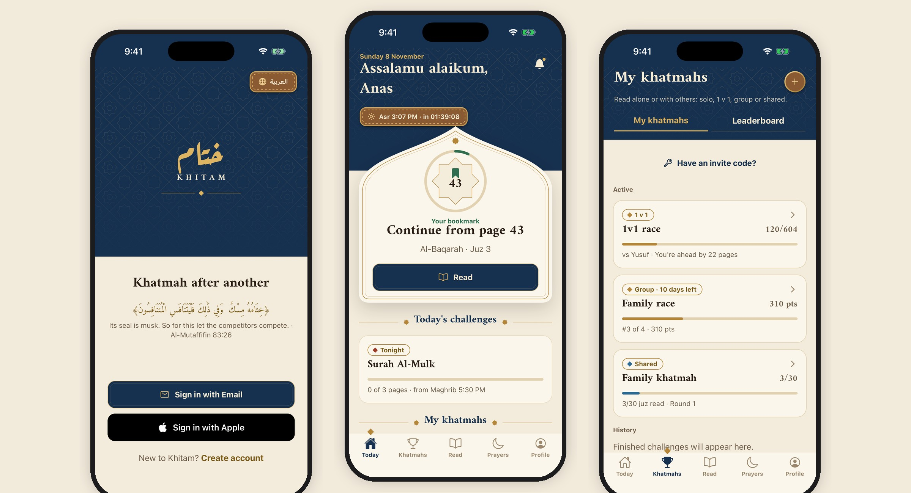

## About

Khitam helps you read the Quran regularly and finish what you start. Your bookmark keeps the last page you read, each day brings a short reading challenge timed to the prayers, and you can start a khatmah alone or with others: race a friend, compete as a group, or split the 30 juz with your family.

The app is fully bilingual. Arabic is right-to-left from the first screen, and English is one tap away.

## Features

**Mushaf reader.** The Madinah Mushaf, page by page, with surah and juz headers, search and tafsir al-Muyassar. Your bookmark carries over between sessions, so free reading always continues from your last page.

**Four ways to read a khatmah.**

| Type | How it works |
| :--- | :--- |
| Solo | Your own khatmah at your own pace. |
| 1 v 1 | Two readers race to finish first, with a live page count for each. |
| Group | Several readers compete over a set number of days and earn points for pages read. |
| Shared | A family or circle splits the 30 juz, and each person reads their part. |

Friends join with an invite code or link.

**Daily challenges.** Surat Al-Kahf on Friday before Maghrib and Surat Al-Mulk at night, shown on the Today screen with a reminder when they open.

**Leaderboard.** An opt-in public board, weekly and monthly, ranked by days read in the app. You choose whether to appear, and can show only your flag instead of your name.

**Prayer times from official sources.** Times come from each country's religious authority rather than a generic calculation: the Ministry of Endowments and Religious Affairs in Oman, the Umm al-Qura calendar in Saudi Arabia, and the General Authority of Islamic Affairs and Endowments in the UAE. Qatar, Kuwait and Bahrain are next. Pick your governorate on a map during setup.

**Mishkat design.** A parchment-and-lapis look with gold accents, an eight-pointed star motif and Arabic calligraphic type, in day and night appearance.

## Screens

<table>
  <tr>
    <td align="center">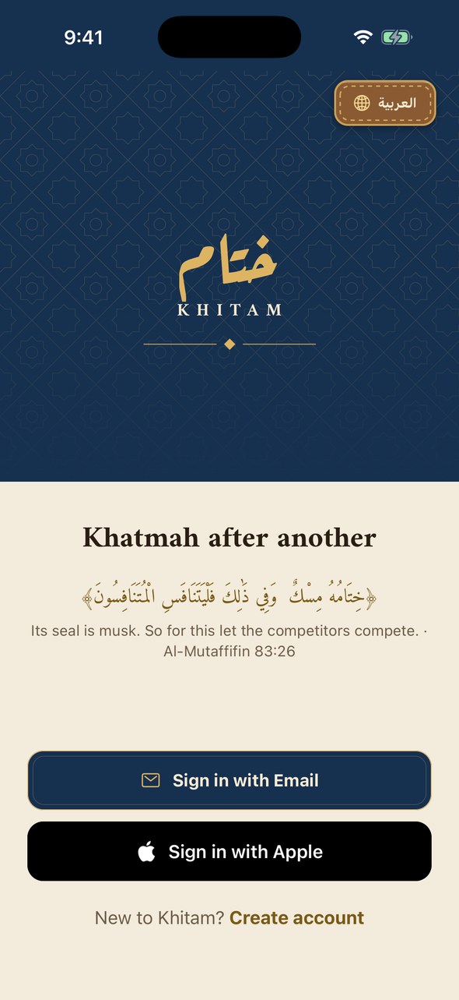 Welcome</td>
    <td align="center">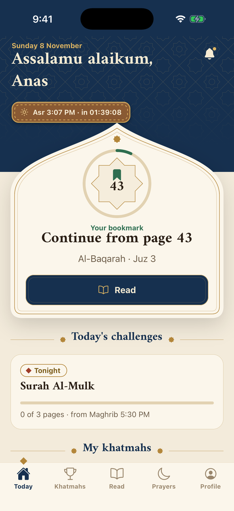 Today</td>
    <td align="center">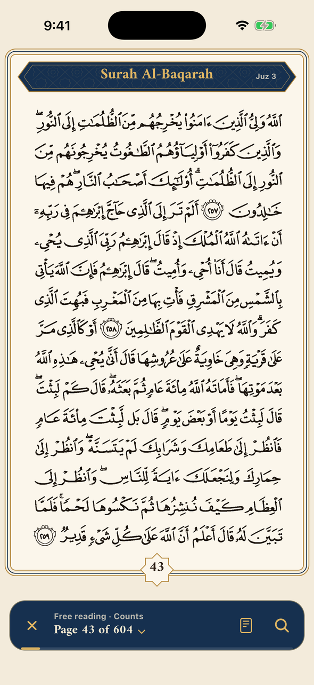 Mushaf reader</td>
    <td align="center">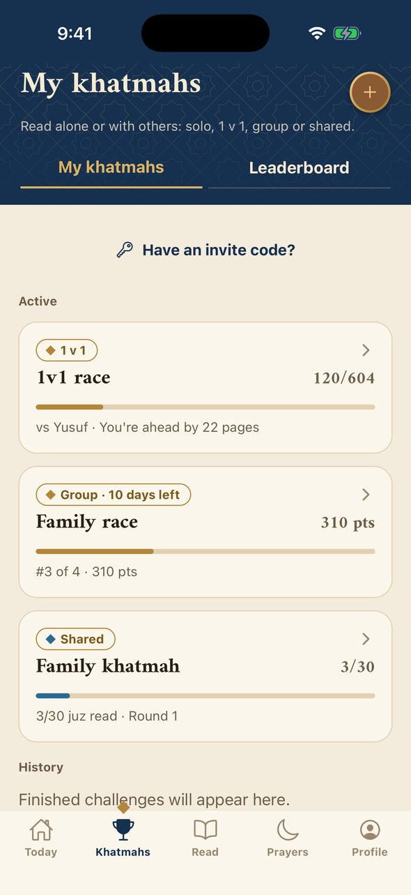 My khatmahs</td>
  </tr>
  <tr>
    <td align="center">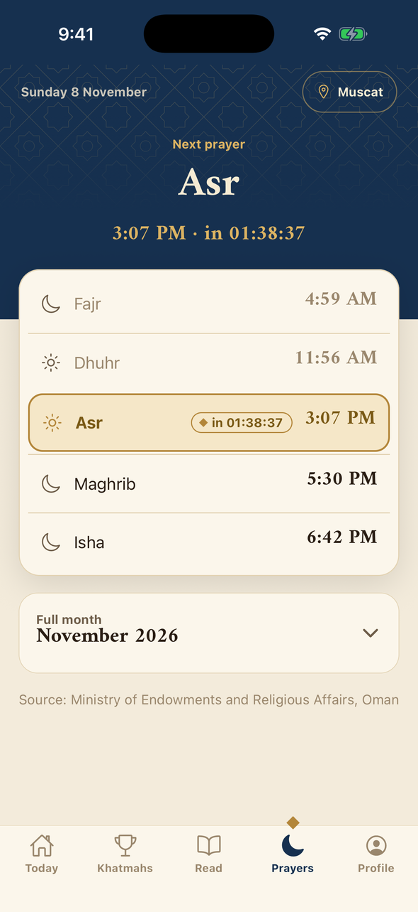 Prayer times</td>
    <td align="center">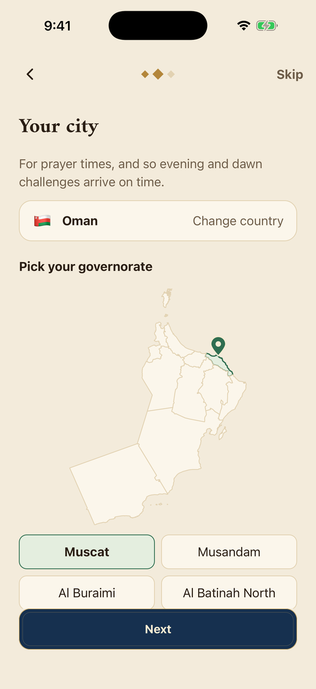 Choosing your city</td>
    <td align="center">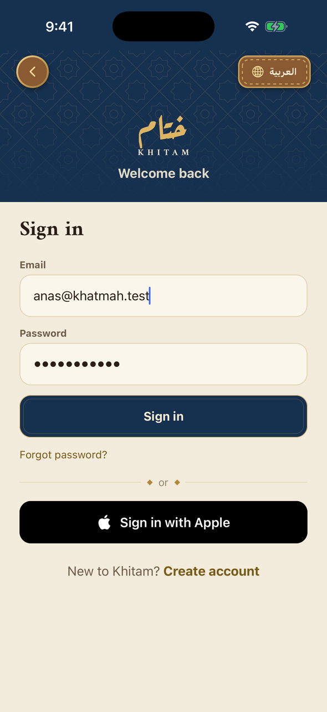 Sign in</td>
    <td align="center">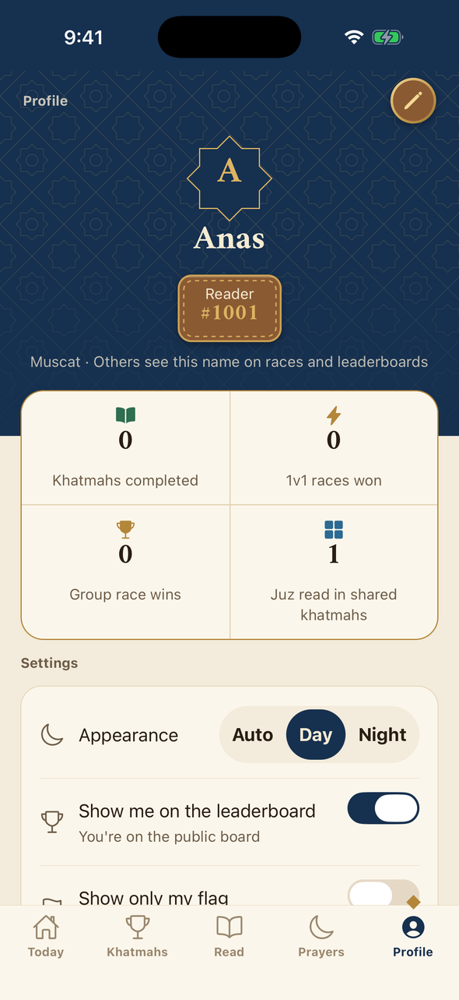 Profile</td>
  </tr>
</table>

## Built with

- **App:** React Native with Expo and Expo Router, written in TypeScript
- **Backend:** Firebase Authentication, Cloud Firestore and Cloud Functions
- **Sign-in:** email and Sign in with Apple
- **Notifications:** Expo push notifications through APNs and FCM

The source code is kept in a private repository. This repository presents the app.

## Status

Khitam is in active development and is being prepared for the App Store and Google Play.

## Sources and credits

- Mushaf: the Madinah Mushaf, King Fahd Glorious Qur'an Printing Complex. Page images via Quran.com.
- Tafsir: al-Muyassar, King Fahd Glorious Qur'an Printing Complex. Quran data provided by Quran.Foundation.
- Page and juz data: Tanzil Project (tanzil.net), CC BY 3.0.
- Prayer times: Ministry of Endowments and Religious Affairs (Oman), Umm al-Qura Calendar by King Abdulaziz City for Science and Technology (Saudi Arabia), General Authority of Islamic Affairs and Endowments (UAE).
- Maps: © OpenStreetMap contributors, ODbL.

---

## بالعربية

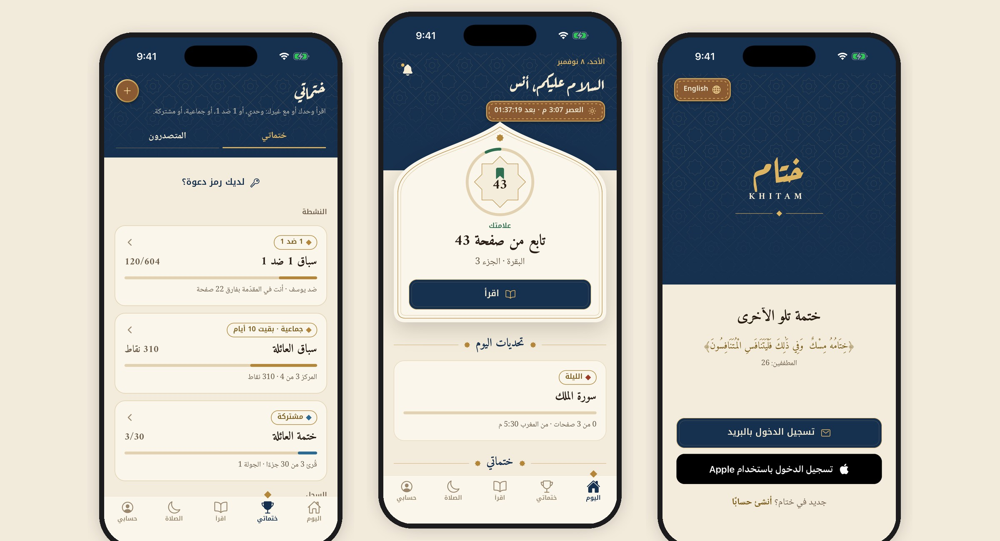

**ختام** رفيقك في قراءة القرآن على الآيفون والأندرويد. اقرأ في المصحف، واحفظ موضعك، وأتمّ ختماتك وحدك أو مع أهلك وأصدقائك.

### المزايا

- **المصحف:** مصحف المدينة النبوية صفحةً صفحة، مع البحث والتفسير الميسّر، وعلامة تحفظ آخر صفحة قرأتها.
- **أربعة أنواع من الختمات:** وحدي، وسباق ١ ضد ١، وسباق جماعي بالنقاط، وختمة مشتركة يتقاسم فيها الأهل الأجزاء الثلاثين.
- **تحديات اليوم:** سورة الكهف يوم الجمعة قبل المغرب، وسورة الملك في الليل، مع تذكير في وقتها.
- **لوحة المتصدرين:** أسبوعية وشهرية بحسب أيام القراءة، والظهور فيها باختيارك.
- **مواقيت الصلاة من مصادرها الرسمية:** وزارة الأوقاف والشؤون الدينية في سلطنة عُمان، وتقويم أم القرى في السعودية، والهيئة العامة للشؤون الإسلامية والأوقاف في الإمارات، وقطر والكويت والبحرين قريبًا.
- **تصميم مشكاة:** ألوان الرَّق واللازورد والذهب، ونجمة ثمانية، وخطوط عربية، بمظهر نهاري وليلي.

<table>
  <tr>
    <td align="center">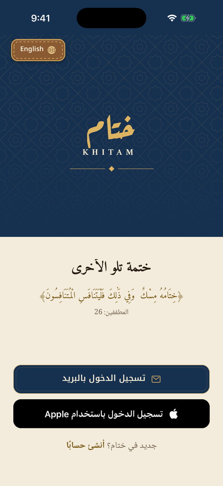 الترحيب</td>
    <td align="center">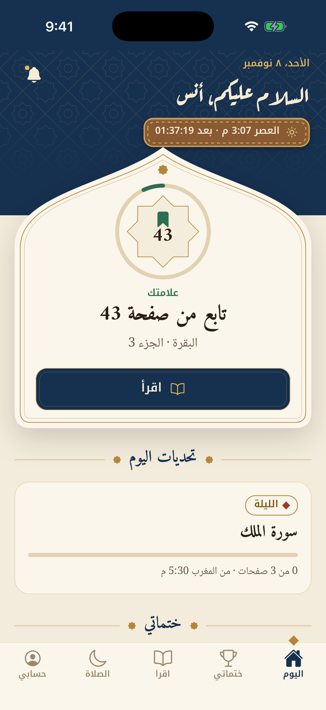 اليوم</td>
    <td align="center">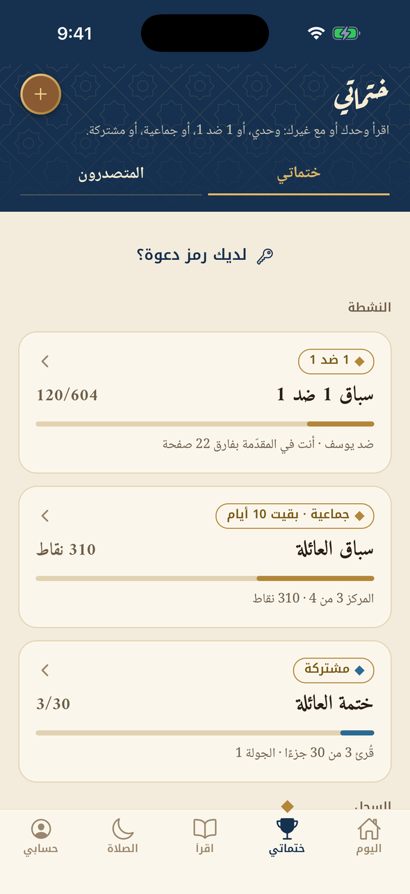 ختماتي</td>
  </tr>
  <tr>
    <td align="center">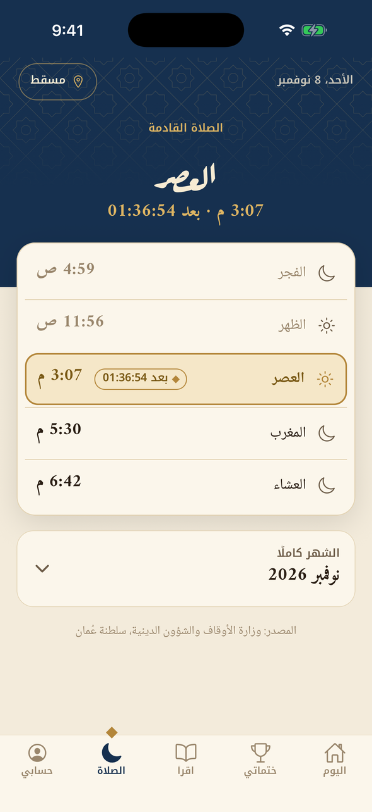 الصلاة</td>
    <td align="center">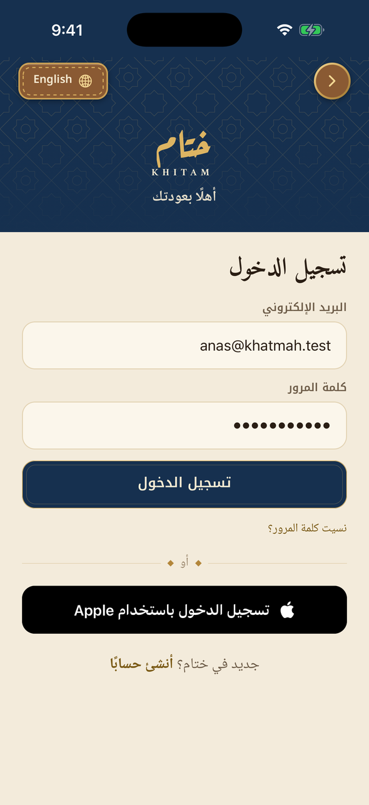 تسجيل الدخول</td>
    <td align="center">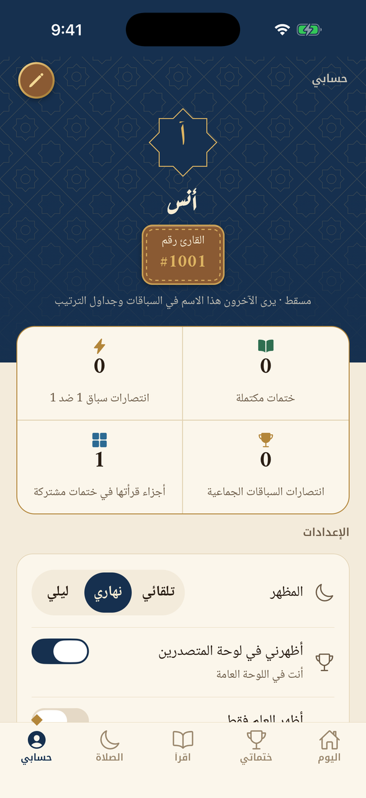 حسابي</td>
  </tr>
</table>

التطبيق قيد التطوير، ويُجهَّز للنشر في App Store و Google Play.

